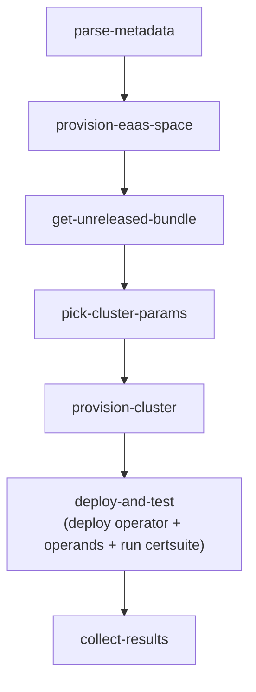
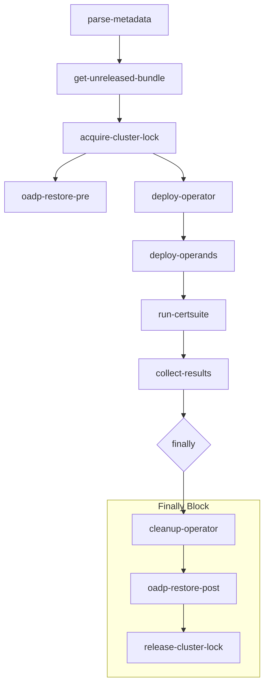
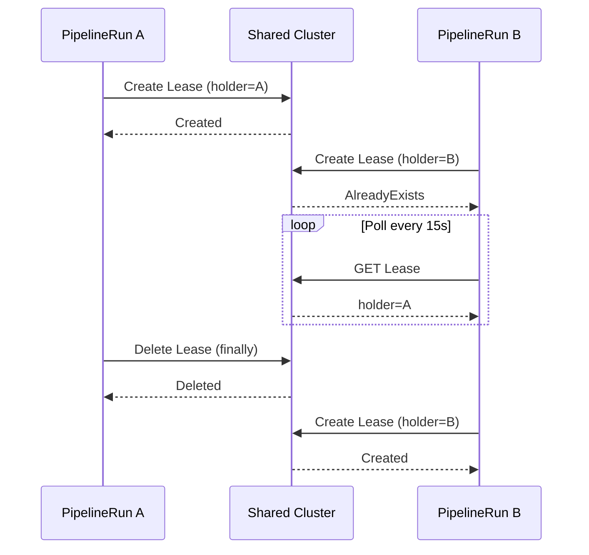
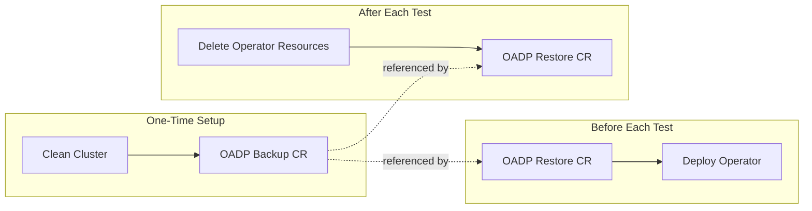
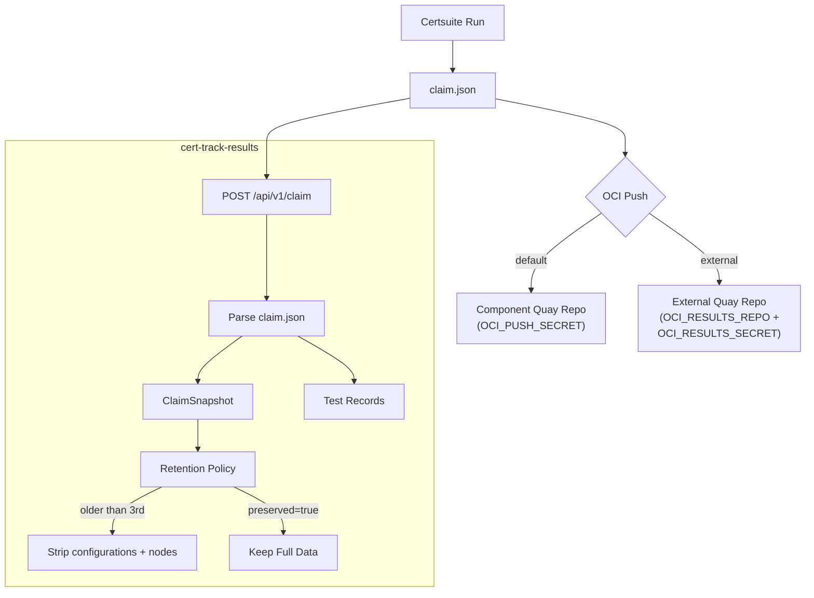

# Architecture Guide

This document describes the Konflux Certsuite test pipelines, how
clusters are provisioned or managed, and how results flow to storage.

There are two pipeline variants:
- **EaaS** (recommended) -- ephemeral cluster per run, no infrastructure to manage
- **Shared Cluster** -- persistent cluster with locking and OADP cleanup

## EaaS Pipeline (Recommended)

Each run provisions a fresh Hypershift cluster via Konflux EaaS. No
kubeconfig secrets, no locks, no cleanup -- the cluster is destroyed
automatically when the PipelineRun completes.



| Stage | What it does |
|-------|-------------|
| `provision-eaas-space` | Allocates an EaaS space for cluster provisioning |
| `get-unreleased-bundle` | Extracts the operator bundle from the FBC fragment |
| `pick-cluster-params` | Reads FBC target minor; maps to a supported EaaS version (fallback if needed) and bundle arch |
| `provision-cluster` | Resolves latest z-stream for that minor and creates an ephemeral Hypershift AWS cluster |
| `deploy-and-test` | Gets kubeconfig, deploys operator via OLM, deploys operands from test bundle, runs certsuite |
| `collect-results` | Optionally pushes claim.json to cert-track-results and/or OCI |

## Shared Cluster Pipeline

Uses a pre-existing cluster accessed via kubeconfig Secret. Includes
Lease-based queueing and OADP backup/restore for multi-tenant safety.



### Stage Details

| # | Task | Purpose |
|---|------|---------|
| 1 | `parse-metadata` | Extract FBC image, git URL, and revision from the Konflux Snapshot |
| 2 | `get-unreleased-bundle` | Retrieve the unreleased operator bundle from the FBC fragment |
| 3 | `acquire-cluster-lock` | Create a Kubernetes Lease to serialize access to the shared cluster |
| 4 | `oadp-restore-pre` | Restore the cluster to the clean baseline using OADP |
| 5 | `deploy-operator` | Install the operator via OLM (CatalogSource, Subscription, CSV) |
| 6 | `deploy-operands` | Apply the test bundle's operand manifests and wait for readiness |
| 7 | `run-certsuite` | Execute certsuite suites specified by the `CERTSUITE_LABELS` param |
| 8 | `collect-results` | POST claim.json to cert-track-results, push tarball to OCI registry |

## Concurrency: Lease-Based Queueing

Multiple Konflux projects can share the same test cluster. A Kubernetes
Lease in the `certsuite-locks` namespace acts as a mutex:



**Stale lock protection**: each Lease carries a `leaseDurationSeconds` (TTL).
If a pipeline crashes without running its `finally` block, the next pipeline
detects the expired lease and deletes it automatically.

## OADP Backup / Restore

The pipeline uses OADP (OpenShift API for Data Protection, built on Velero)
to snapshot and restore cluster state:



**What OADP restores**: namespace-scoped resources (Deployments, Services,
ConfigMaps, Secrets, PVCs) and cluster-scoped resources (CRDs,
ClusterRoles). It does *not* restore etcd or OpenShift platform operators.

**What the cleanup task removes**: the explicit OLM resources (Subscription,
CSV, CatalogSource, OperatorGroup), operator-installed CRDs, and the
install/operand namespaces. OADP restore then handles any remaining drift.

## Operator Test Bundle

The test bundle is a directory (hosted in a git repo or OCI image) that
operator owners create. It tells the pipeline how to deploy operands in
a software-only mode and verify the operator is properly deployed. The
bundle also includes `certsuite_config.yml`, which tells certsuite where
to find the operator's workloads (namespaces, labels, CRD filters).

```
my-operator-test-bundle/
  certsuite-test-bundle.yaml    # Bundle metadata (namespace, readiness, csvPatches, etc.)
  certsuite_config.yml          # Required: certsuite runtime config (namespaces, labels, CRD filters)
  prerequisites/                # (optional) Secrets, ConfigMaps needed first
    secret.yaml
  operands/                     # Kubernetes manifests for operand instances
    my-custom-resource.yaml
    deployment.yaml
    service.yaml
  csv-patches/                  # (optional) JSON6902 / strategic-merge CSV patches
    00-example.json
```

The bundle is fetched **before** operator install (not just before
operand deployment). This allows the pipeline to read install
configuration from the bundle:

- **`spec.namespace`** -- used as the install namespace for both the
  operator and operands. Falls back to the CSV `suggested-namespace`
  annotation, then auto-generates an `oo-*` namespace.
- **`spec.installMode`** -- determines the OperatorGroup configuration
  (`AllNamespaces`, `OwnNamespace`, `SingleNamespace`, `MultiNamespace`).
  Falls back to auto-detection from the CSV's supported install modes.
- **`spec.discoveryLabels`** -- controls which labels are applied to
  the installed CSV and workload pods for certsuite discovery, and which
  resource kinds (Deployment, DaemonSet, StatefulSet) get labeled.

This design makes the pipeline **operator-agnostic**: all
operator-specific decisions live in the test bundle, not in pipeline
logic. The shared `resolve-bundle-config.sh` script handles the
resolution with CSV-based fallbacks for backward compatibility.

By default, the pipeline runs **all** certsuite tests. Pass
`CERTSUITE_LABELS` to run only a subset.

See the [Operator Onboarding Guide](operator-onboarding-guide.md) for
how to create a bundle, and the
[ptp-operator](../examples/ptp-operator-test-bundle/) or
[lifecycle-agent](../examples/lifecycle-agent-test-bundle/) examples for
real-world references.

## Results Flow



### OCI Results Storage

Results are pushed as OCI artifacts (via `oras`) with artifact type
`application/vnd.certsuite.results.v1+gzip`. Two modes are supported
(EaaS pipeline):

| Mode | Parameters | Tag format | Description |
|------|-----------|------------|-------------|
| **Component repo** (default) | `OCI_PUSH_SECRET` | `<pr\|merged>-<timestamp>` | Results are tagged on the same Quay repo as the FBC/component image. |
| **External repo** | `OCI_RESULTS_REPO` + `OCI_RESULTS_SECRET` | `<package>[-<ocp-release>]-<pr\|merged>-<timestamp>` | Results are pushed to a dedicated OCI registry. `ocp-release` is the FBC target minor (not a pipeline param). `pr`/`merged`, FBC target, and the provisioned cluster version (`ocp-version-actual`) are set as OCI annotations; PR artifacts get `quay.expires-after=7d`. |

`OCI_RESULTS_REPO` must be a bare repository reference (no `:tag` or
`@digest`). Host:port forms such as `registry.example.com:5000/repo` are
accepted. When the external repo is set without a usable
`OCI_RESULTS_SECRET`, the step fails explicitly (no credential fallback).
Push failures and misconfigured credentials log a clear ERROR (target +
secret to fix); the step uses `onError: continue` so the PipelineRun is
not failed — same non-fatal policy as the original component-repo push.

Download results:
```bash
oras pull <OCI_REF from push-results logs>
tar xzf certsuite-results.tar.gz
```

### Retention Policy

For each `(operator, release)` pair:

1. The **3 newest** ClaimSnapshots retain full debug data (`configurations`
   and `nodes` sections from claim.json).
2. Older snapshots have `configurations` and `nodes` set to NULL to save
   space. Per-test fields (`checkDetails`, `capturedTestOutput`) are always
   kept.
3. Users can mark a snapshot as **preserved** via the cert-track-results UI
   to exempt it from stripping.

## Adding a New Operator

1. Create a [test bundle](#operator-test-bundle) in your operator's
   repository.
2. Validate it locally with `tools/validate-test-bundle.sh`.
3. Create an `IntegrationTestScenario` in your Konflux tenant config.
   See [examples/integration-test-scenario-eaas.yaml](../examples/integration-test-scenario-eaas.yaml).
4. Ensure the required Secrets exist in your tenant namespace:
   - **EaaS (recommended):**
     - `REGISTRY_PULL_SECRET` -- `dockerconfigjson` Secret for
       `registry.redhat.io` (required for unreleased operators)
     - (optional) component ImageRepository push secret via `OCI_PUSH_SECRET`
     - (optional) external results secret via `OCI_RESULTS_SECRET` when
       using `OCI_RESULTS_REPO` (must be `kubernetes.io/dockerconfigjson`
       with push access to that repo)
   - **Shared cluster:**
     - `shared-cluster-kubeconfig` -- kubeconfig for the shared cluster
     - `cert-track-api-token` -- API token for cert-track-results (optional)
     - registry credentials for `OCI_REF` (optional)
5. Merge a change to your FBC component -- the pipeline triggers
   automatically on push events.
